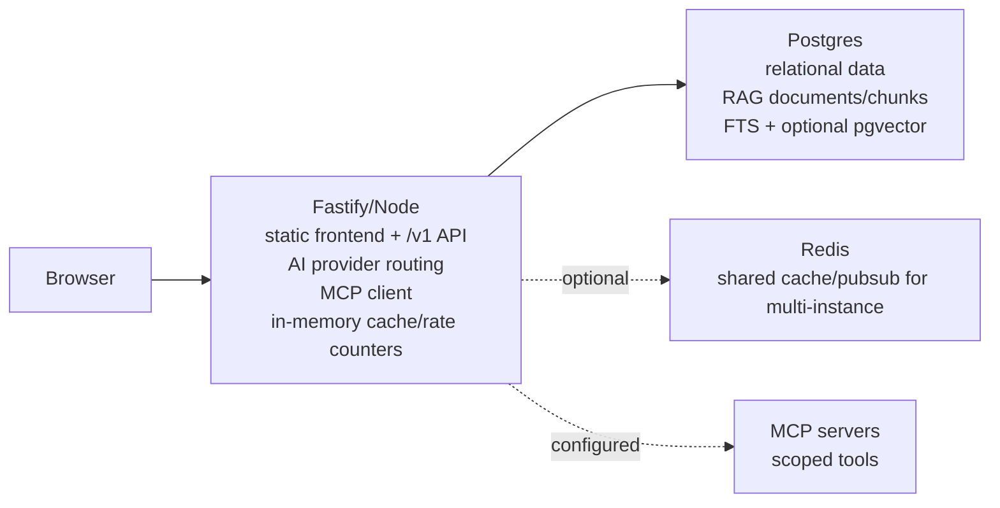

# MEOW CODE

MEOW CODE is a Next.js static frontend plus Fastify API for routing chat requests across configured AI providers. The production target is a single Node process on one port, backed by Postgres.



## Requirements

- Node 22 in CI/Render, Node 20+ minimum for dependencies.
- npm, using the committed `package-lock.json`.
- Postgres. Use a pgvector-capable Postgres image or extension for migrations that create `vector`.
- Required secrets: `DATABASE_URL`, `MEOW_AUTH_SECRET`, `MEOW_ENCRYPTION_KEY`, `MEOW_WEB_URL`, `MEOW_API_URL`.

## Local Development

1. Install dependencies:
   ```bash
   npm ci
   ```
2. Start Postgres:
   ```bash
   docker compose up postgres
   ```
3. Configure `.env` from `.env.example`.
4. Generate Prisma and run migrations:
   ```bash
   npm run db:generate
   npm run db:migrate
   ```
5. Run development services:
   ```bash
   npm run dev:api
   npm run dev
   ```

The web dev server runs on `127.0.0.1:3000`; the API defaults to port `4000`.

## Production Build And Start

```bash
npm ci
npm run render:build
npm run db:migrate:deploy
npm start
```

In production, Fastify serves `apps/web/out` and `/v1/*` from the same process. It binds `0.0.0.0` and reads `process.env.PORT`.

## Render

`render.yaml` defines one web service and one managed Postgres database. Redis is not created by default. Set these Render env vars manually:

- `MEOW_AUTH_SECRET`
- `MEOW_ENCRYPTION_KEY`
- `MEOW_WEB_URL`
- `MEOW_API_URL`
- OAuth credentials as needed
- `MEOW_MCP_SERVERS` only when MCP servers are intentionally configured

The Render start command runs `npm run db:migrate:deploy && npm start`. Health checks use `/health`.

## Redis Fallback

Redis is optional. Without `REDIS_URL`, the API uses an in-memory provider for cache, TTL counters, and lightweight pubsub. This state is bounded, expires by TTL, and is lost on restart. It is suitable only for a single Node process. Set `REDIS_URL` for shared cache/pubsub in horizontal or multi-instance deployments.

## Postgres RAG

RAG uses the existing Postgres database:

- `Document` and `DocumentChunk` are workspace-scoped.
- Chunks cascade-delete with their parent document.
- Deduplication uses SHA-256 content hashes per workspace.
- Full-text search uses generated `tsvector` columns and GIN indexes.
- `pgvector` columns and indexes are present for embeddings, but embeddings are optional. If no embedding provider is configured, retrieval works as FTS-only.

API endpoints:

- `POST /v1/rag/documents`
- `GET /v1/rag/search?q=...`
- `DELETE /v1/rag/documents/:id`

## MCP

MCP is disabled unless `MEOW_MCP_SERVERS` is set to a JSON array. Each server config declares command, args, workspace allowlist, tool allowlist, and timeout. The API exposes only authenticated workspace-scoped discovery and invocation endpoints under `/v1/mcp/*`. MCP secrets and server configuration are never exposed to the frontend.

## Troubleshooting

- `/health` should return `{ "ok": true }` without requiring database or Redis.
- If startup fails at migrations, verify `DATABASE_URL` and pgvector extension availability.
- If chat returns no models, connect and sync at least one provider for the workspace.
- If MCP calls fail, verify the configured server command exists in the deployed runtime and that `allowedTools` includes the requested tool.
- Leave `NEXT_PUBLIC_MEOW_API_URL` unset in production so the browser uses same-origin `/v1/*`.
